<p align="center">
  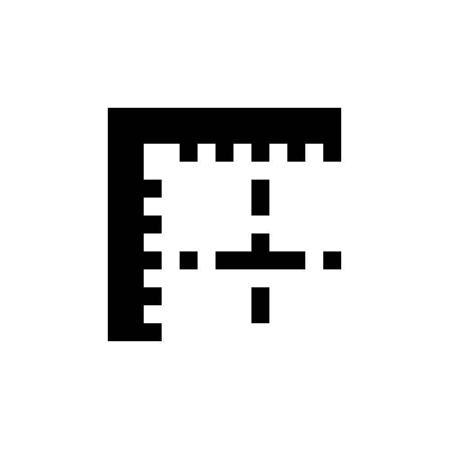
</p>

<h1 align="center">Grafo<br><sub><sup><sup><sub>Copyright (©) 2026 Erik Pimenta</sub></sup></sup></sub></h1>

<p align="center">
  Editor colaborativo de design de interfaces e de diagramas que roda no navegador. Desenhe telas com frames, vetores, caneta, texto e imagens, organize com auto layout, restrições, componentes, estilos e operações booleanas, monte fluxogramas, UML, entidade-relacionamento, BPMN, redes e organogramas com conectores que desviam das formas, ligue os frames num protótipo clicável e edite tudo junto com outras pessoas, vendo os cursores em tempo real. Exporta PNG, JPG, SVG, PDF e o próprio arquivo <code>.grafo</code>.<br>
  Roda de três maneiras: app desktop para Windows (<code>Grafo.exe</code>), servidor completo com colaboração (Docker Compose) ou com dois cliques no <code>Grafo.html</code> (ou no <code>index.html</code>), sem instalar nada.<br>
  Ou abra direto no navegador, sem baixar nada: <a href="https://ravelroot.github.io/Collaborative-Design-and-Diagram-Editor/">ravelroot.github.io/Collaborative-Design-and-Diagram-Editor</a>.<br>
  Pronto para baixar e usar.
</p>

<p align="center">
  JavaScript (módulos ES) · HTML5 · CSS3 · PixiJS 8 (WebGL2 e WebGPU) · C++17 → WebAssembly (Emscripten) · Rust (Tokio + Axum) · Yjs / Yrs + WebSockets · PostgreSQL 17 · Redis 7 · NATS JetStream · Go 1.24 + WebView2 (app desktop) · Docker Compose · Node Test Runner · Playwright
</p>

---

> **Manual completo:** [`Manual-Grafo.pdf`](Manual-Grafo.pdf) explica as três maneiras de rodar (app desktop, servidor completo e dois cliques no HTML), o tutorial rápido, a galeria **Novo quadro** com os modelos, os padrões de projeto e a aula, a tela, cada ferramenta e atalho (inclusive ações rápidas, medição, conta-gotas e guias), frames, auto layout, restrições, componentes, estilos, booleanas, as bibliotecas de formas, conectores, contêineres e raias, layout automático, dados em CSV e organograma, protótipo e apresentação, comentários, versões, colaboração, importação e exportação, a arquitetura, a API, a configuração, a segurança, os testes, a solução de problemas e as novidades da 1.3.0 (diagrama a partir de texto, localizar e substituir, tabelas, grade de encaixe, estilo rápido e métricas do servidor), passo a passo (cópia em [`docs/`](docs/Manual-Grafo.pdf)).

> **Banco de dados:** [`Banco-de-Dados-Grafo.pdf`](Banco-de-Dados-Grafo.pdf) traz o diagrama de relacionamentos geral e por domínio, todas as tabelas com campos, tipos, chaves e restrições, os tipos ENUM e índices, o ciclo de vida do documento colaborativo (update → sequência → compactação → versão), o formato binário Yrs, as chaves do Redis e os subjects do NATS, consultas prontas, como preparar o PostgreSQL, as regras de integridade, retenção e segurança dos dados e o que a 1.3.0 muda (nada no esquema; só propriedades novas dentro do documento e as métricas).

> **Versão 1.3.0 (Atual):** chegou o **diagrama a partir de texto** (Ctrl+Alt+M): escreva um fluxograma em **Mermaid** ou uma **lista com recuo** e o Grafo desenha as formas, os conectores, os rótulos e os grupos já organizados, e **Copiar como Mermaid** faz o caminho de volta. Também chegaram **localizar e substituir** em todas as páginas (Ctrl+F / Ctrl+H), **tabelas** (Shift+T ou a partir de um CSV), **grade de encaixe** configurável, **espaço exato entre itens**, **estilo rápido** com oito combinações de cor, **conectar em sequência** (Ctrl+Alt+X), **paletas de cores** da interface, o **indicador de salvamento** na barra de status, atalhos na **página vazia** e a rota **`/api/metrics`** no servidor. Corrigidos: o Tab não cobre mais o canvas com a camada de acessibilidade do PixiJS e os botões do painel Design mostram o estado novo na hora. Nada muda no banco nem no formato `.grafo`. Detalhes em [Diagrama a partir de texto, busca e tabelas (1.3.0)](#diagrama-a-partir-de-texto-busca-e-tabelas-130).

> **Versão 1.2.0 (Anterior):** chegou o **Novo quadro** (Ctrl+Alt+N): escolha um tipo de diagrama e o quadro abre já montado para editar, entre **63 modelos** em dez categorias (UML e SysML, processos, arquitetura, dados, infraestrutura, segurança, testes, UX e produto, gestão e análise) e **46 padrões de projeto** que abrem como diagrama ou como aula. No modo **Aula** você começa por uma raiz no topo e desce pelas ramificações, abre as ideias para os lados ou conta a história no sentido inverso; Tab cria uma ramificação e Enter uma ideia irmã. Se preferir, comece em branco. Também chegaram ferramentas de edição profissional: **ações rápidas** (Ctrl+K) para achar qualquer comando, ferramenta, página, forma ou camada pelo nome; **medição de distâncias** com Alt; **conta-gotas** (I); **guias** puxadas das réguas, com encaixe; **copiar e colar propriedades**; **organizar em grade**; **renomear em lote** (F2); **travar proporção**; **ajustar frame ao conteúdo**; **maiúsculas e minúsculas** no texto; **copiar como PNG**; busca no painel **Camadas**; Tab para andar pelas camadas e Ctrl+D que repete o último deslocamento. O **espelhar** agora inverte de verdade formas, imagens e seleções inteiras. Nada muda na API nem no banco; arquivos `.grafo` antigos abrem normalmente. Detalhes em [Novo quadro: modelos e aula (1.2.0)](#novo-quadro-modelos-e-aula-120) e [Ferramentas profissionais (1.2.0)](#ferramentas-profissionais-120).

<p align="center">
  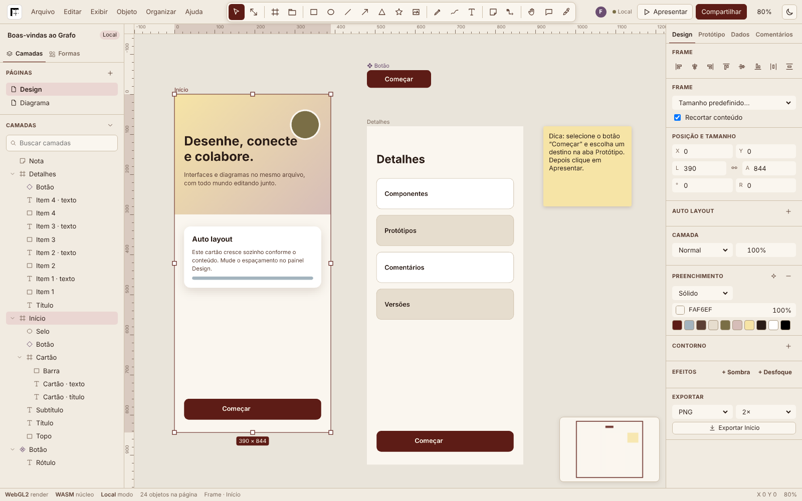
</p>

## O que o Grafo faz

- **Ferramentas de desenho:** mover, escala, frame, seção, retângulo, elipse, linha, seta, polígono, estrela, imagem, caneta com curvas de Bézier, lápis à mão livre (simplificado e suavizado no núcleo WebAssembly), texto, nota adesiva, conector, mão e comentário, todas com atalho de uma tecla. Shift trava proporção e ângulos, Alt desenha do centro e Ctrl desliga o encaixe.
- **Seleção e transformação:** clique, Shift + clique e seleção por área; oito alças de redimensionar, giro livre ou de 15° em 15°, **guias inteligentes** que encaixam bordas e centros, encaixe em pixels inteiros, setas para mover 1 ou 10 px, alinhar e distribuir, espelhar, agrupar, bloquear e ocultar.
- **Frames e auto layout:** frames com recorte, raio, preenchimento, contorno e efeitos, com tamanhos prontos (celular, tablet, notebook, desktop, slide 16:9, A4, post e story). O **auto layout** empilha os filhos na horizontal ou na vertical, com espaçamento, margem, alinhamento, distribuição, esticar e abraçar o conteúdo; fora dele, as **restrições** dizem o que cada filho faz quando o frame muda de tamanho.
- **Componentes e estilos:** transforme qualquer seleção em componente e crie instâncias que acompanham o principal, com **substituições** de texto e cor, restauração e desanexar. Estilos de cor e de texto com nome: editar o estilo muda todos os objetos que o usam.
- **Aparência:** cor sólida com opacidade, degradê linear, imagem (preencher, ajustar ou esticar), contorno dentro, no centro ou fora, contínuo, tracejado ou pontilhado, sombra projetada, desfoque, opacidade e **16 modos de mistura**. Texto com seis famílias, peso, tamanho, altura de linha, espaçamento, alinhamento horizontal e vertical, itálico e sublinhado.
- **Operações booleanas:** união, subtração, interseção e exclusão, calculadas no núcleo C++ e editáveis depois (as formas originais continuam dentro).
- **Diagrama a partir de texto:** escreva um fluxograma em Mermaid (`flowchart TD`, `A[Início] --> B{Decisão}`, rótulos, setas tracejadas e grossas, `&` e `subgraph`) ou uma lista com recuo e o quadro aparece montado e organizado; **Copiar como Mermaid** exporta a seleção ou a página de volta para texto.
- **Diagramas:** **107 formas** em oito bibliotecas (básicas, fluxograma, UML, entidade-relacionamento, BPMN, rede e nuvem, organograma, wireframe e interface). Conectores **retos, ortogonais ou curvos** presos aos pontos de conexão, que desviam das outras formas pelo roteador A* do núcleo, com rótulo e dez tipos de ponta (inclusive pé-de-galinha do ER). Passe o mouse numa forma e puxe um ponto para ligar ou clonar.
- **Contêineres e layout automático:** piscinas, raias, limites de rede e equipes levam junto as formas de dentro. **Organizar → Layout automático** reorganiza o diagrama em camadas (Sugiyama) e anima as formas até o lugar.
- **Dados:** importe um CSV, ligue uma forma a uma linha e use `{{coluna}}` no texto; gere cartões ou um **organograma** inteiro (cartões, conectores e layout) a partir das colunas de id e gestor.
- **Protótipo e apresentação:** ligue qualquer objeto a um frame, escolha a transição e apresente em tela cheia, seguindo os links ou passando os frames como slides.
- **Colaboração em tempo real:** o documento é um CRDT (Yjs no editor, Yrs no servidor). Cada pessoa aparece no topo e com o próprio cursor no canvas, a seleção dos outros fica destacada na cor deles, e desfazer só desfaz o que é seu. Sem o servidor, as abas abertas do mesmo arquivo colaboram entre si.
- **Localizar e substituir:** Ctrl+F acha qualquer texto em todas as páginas (com maiúsculas e palavra inteira opcionais) e leva até ele; Ctrl+H troca em uma camada ou em todas de uma vez, com um só Ctrl+Z para desfazer.
- **Tabelas e grade:** tabelas de qualquer tamanho (ou geradas de um CSV), grade de encaixe de 4 a 50 px, espaço exato entre itens, estilo rápido e conectar em sequência.
- **Comentários e versões:** pinos de comentário com conversa, respostas, resolver e reabrir; versões nomeadas que voltam com um clique (e o Ctrl+Z desfaz a volta).
- **Arquivos:** várias páginas por arquivo, arquivos recentes, salvar e abrir `.grafo`, importar imagens e SVG (arrastando, colando ou pelo menu), colar texto vira texto, exportar PNG, JPG, SVG e PDF (um frame por página) e copiar como SVG.
- **App desktop:** o [`Grafo.exe`](Grafo.exe) abre maximizado numa janela própria do Windows, sem servidor e sem navegador; F11 alterna a tela cheia, os arquivos ficam neste computador e salvar ou exportar abre a janela **Salvar como** do Windows.
- **Tutorial rápido:** na primeira vez que o Grafo abre, ele pergunta se você quer um tour de nove passos pelas ferramentas, painéis, navegação, colaboração e salvar. Dá para pular, e ele fica em **Ajuda → Tutorial rápido**.
- **Leve e fluido:** a barra de status mostra quando o arquivo foi salvo, a página vazia oferece os primeiros passos e a tela só é redesenhada quando algo muda, zoom de 2% a 25.600% no ponto do cursor (roda, pinça ou teclado, com animação suave), réguas, minimapa, grade de pixels, temas claro e escuro e interface que some com Ctrl+\\.
- **Paletas de cores:** o botão de paleta no topo troca a interface entre a paleta original do Grafo e as do Bento, do Sonda e do Nexo, todas com versão clara e escura. A escolha fica salva e volta na próxima vez. Detalhes em [Paletas de cores](#paletas-de-cores).
- **Seguro por padrão:** Content-Security-Policy restrita sem `eval`, nenhum dado do usuário entra como HTML, SVG importado é limpo, o servidor limita tamanho e taxa, confere UUIDs e tipos de imagem pelos bytes e degrada sem cair quando falta um serviço. Detalhes em [Qualidade e segurança](#qualidade-e-segurança).

<p align="center">
  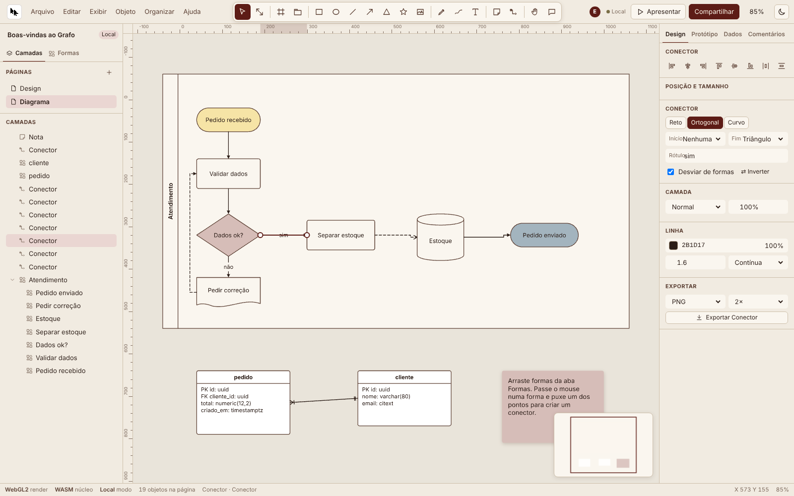
  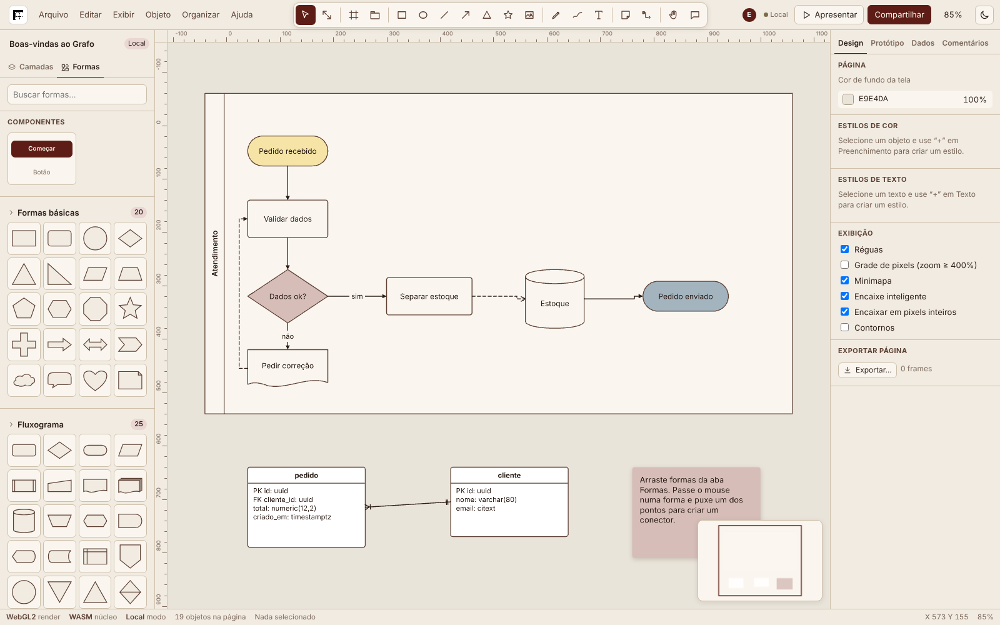
</p>

<p align="center">
  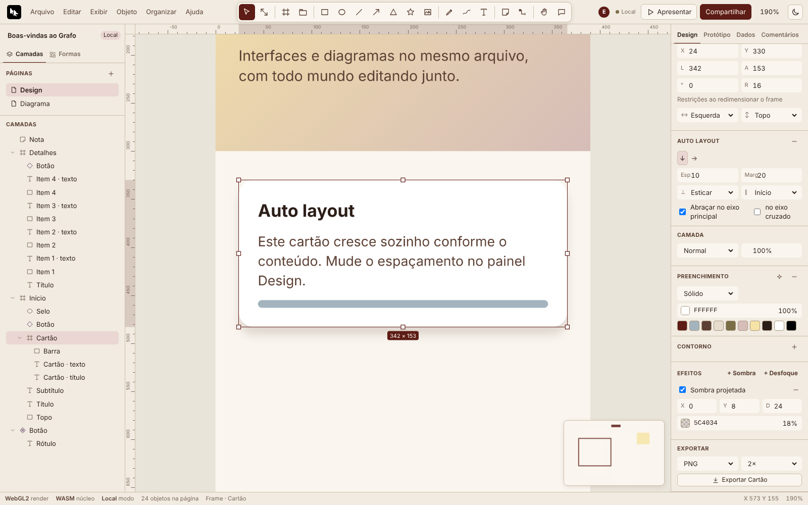
  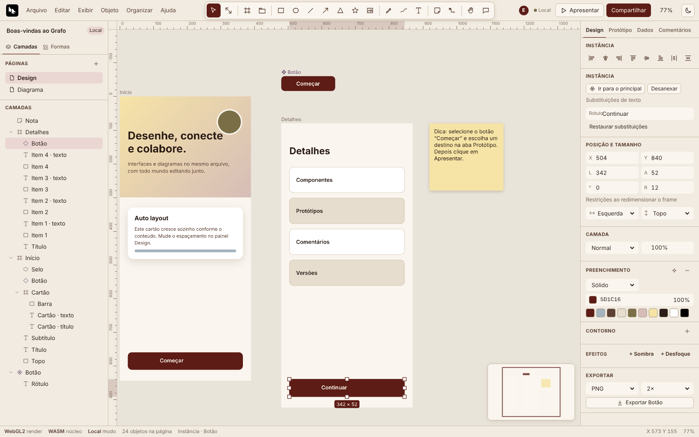
</p>

## Paletas de cores

O botão com o ícone de paleta, no canto superior direito ao lado do botão de tema, abre a lista **Paleta de cores**. A paleta escolhida vale para toda a interface (barra superior, painéis, menus, réguas, seleção, guias e o fundo da tela) e funciona junto com o tema claro ou escuro. As cores dos objetos do arquivo não mudam, e uma cor de fundo escolhida para a página continua valendo.

| Paleta | De onde vem | Tema claro | Tema escuro |
| --- | --- | --- | --- |
| **Grafo** (padrão) | paleta original do Grafo | linho `#E6DDCE`, vinho `#5D1C16`, ardósia `#A3B4BE`, palha `#F6E4A6` | fundo `#1D1613`, destaque palha `#F6E4A6` |
| **Bento** | painel administrativo Bento | mesa `#F5F4F4`, caixa `#FFFFFF`, tinta `#000000`, alta `#3E6B2A`, queda `#9B2F1E` | mesa `#020202`, caixa `#121111`, destaque `#FFFFFF` |
| **Sonda** | motor de busca Sonda | papel `#F3F1EC`, folha `#FCFBF8`, tinta `#17212B`, água `#E3ECEF`, sinal `#A8235A` | papel `#0F161B`, água `#172A33`, sinal `#F0679A` |
| **Nexo** | paleta original do Nexo | papel `#E8E8E8`, pó `#D9D1CE`, pedra `#BAB7B5`, malva `#AB9D9D`, tinta `#000000` | fundo `#000000`, superfície `#121111`, malva `#AB9D9D` |

A escolha fica salva neste navegador (ou no app desktop) e é aplicada antes de a tela aparecer. As paletas são variáveis CSS em `:root[data-palette]` no [`web/css/grafo.css`](web/css/grafo.css), a lista do menu fica em `PALETTES` no [`web/src/util.js`](web/src/util.js), e o canvas lê o fundo e as cores de seleção dessas mesmas variáveis.

## Diagrama a partir de texto, busca e tabelas (1.3.0)

<p align="center">
  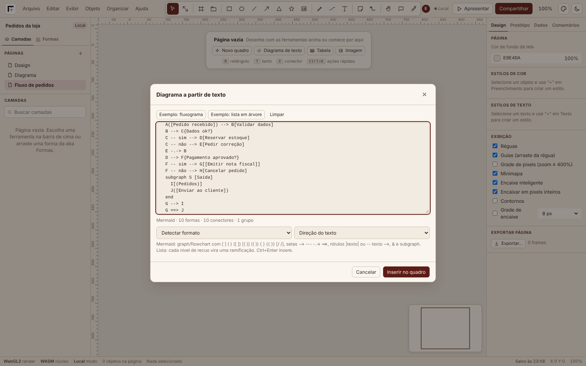
  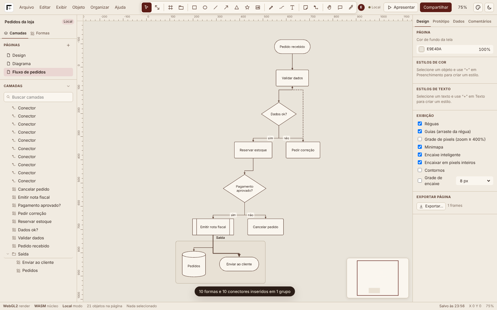
</p>

<p align="center">
  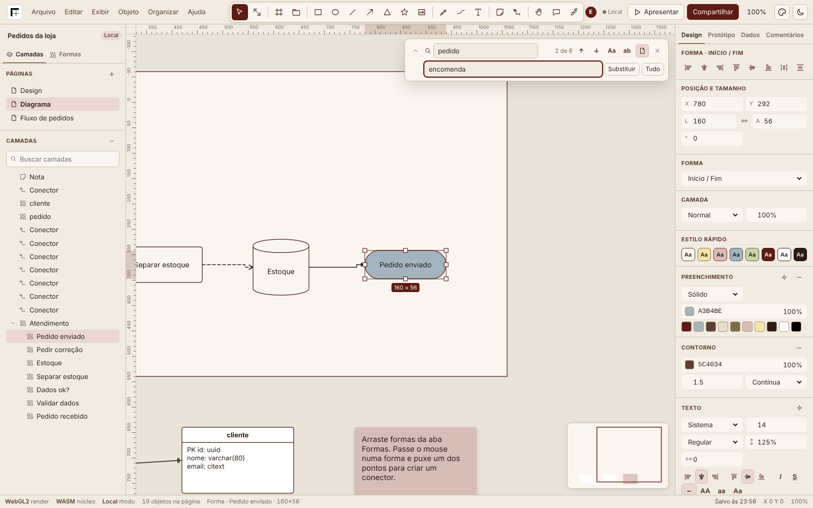
  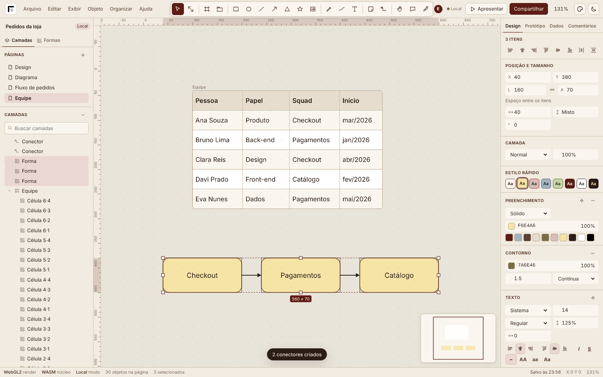
</p>

| Recurso | Como usar | O que faz |
|---|---|---|
| Diagrama a partir de texto | Ctrl+Alt+M ou **Arquivo → Diagrama a partir de texto…** | Lê Mermaid (`graph`/`flowchart` com `TD`, `LR`, `BT` ou `RL`) ou uma lista com recuo, mostra quantas formas e conectores vão entrar e desenha tudo organizado em camadas; Ctrl+Enter insere |
| Copiar como Mermaid | **Arquivo** ou clique direito | Converte a seleção (ou a página) em `flowchart`, mantendo tipos de forma, rótulos e setas tracejadas, grossas ou sem ponta |
| Localizar e substituir | Ctrl+F / Ctrl+H | Busca em textos, formas, notas, seções e rótulos de conectores, na página ou em todas; Enter vai para o próximo, **Tudo** (Ctrl+Enter) substitui em todas as camadas com um só desfazer |
| Inserir tabela | Shift+T, **Objeto** ou clique direito | Frame com uma forma por célula, cabeçalho opcional, até 200 × 24 |
| Tabela a partir de CSV | Aba **Dados → Tabela** | Monta a tabela com as colunas do CSV no cabeçalho e a largura ajustada ao conteúdo |
| Grade de encaixe | Ctrl+Shift+' ou **Exibir** | Pontos no canvas e encaixe ao desenhar, mover e redimensionar em passos de 4 a 50 px; Shift+setas anda um passo |
| Espaço entre os itens | Campos ↔ e ↕ com vários itens | Mostra o espaço atual e aplica um espaço igual entre os itens selecionados |
| Estilo rápido | Seção **Estilo rápido** do painel Design | Oito combinações de preenchimento, contorno e cor do texto da paleta do Grafo |
| Conectar em sequência | Ctrl+Alt+X ou **Organizar** | Liga as formas selecionadas na ordem de leitura, sem repetir ligações |
| Indicador de salvamento | Barra de status | Salvando…, Salvo às 14:32, Sincronizado, Offline ou Não salvo (com a dica de salvar uma cópia) |
| Página vazia | Abra ou crie uma página | Atalhos para Novo quadro, Diagrama de texto, Tabela e Imagem e as teclas mais usadas |

| Mermaid | Forma | Mermaid | Forma |
|---|---|---|---|
| `A[texto]` | Processo | `A{texto}` | Decisão |
| `A(texto)` | Arredondado | `A{{texto}}` | Preparação |
| `A([texto])` | Início / fim | `A[/texto/]` | Dados |
| `A[[texto]]` | Processo predefinido | `A[(texto)]` | Banco de dados |
| `A((texto))` | Círculo | `A>texto]` | Divisa |

Setas: `-->` (com ponta), `---` (sem ponta), `-.->` (tracejada), `==>` (grossa), `-->|rótulo|` ou `-- rótulo -->` e `A & B --> C`. Um `subgraph` vira uma seção quando não encosta em outras formas. O texto aceita até 400 formas e 800 conectores por vez.

Também foram corrigidos: o Tab ativava uma camada invisível de acessibilidade do PixiJS sobre o canvas, que engolia o próximo clique; os botões do painel Design (itálico, alinhamento, estilos) só mostravam o estado novo na próxima seleção; e cada arquivo aberto deixava um ouvinte de saída da página para trás.

## Novo quadro: modelos e aula (1.2.0)

<p align="center">
  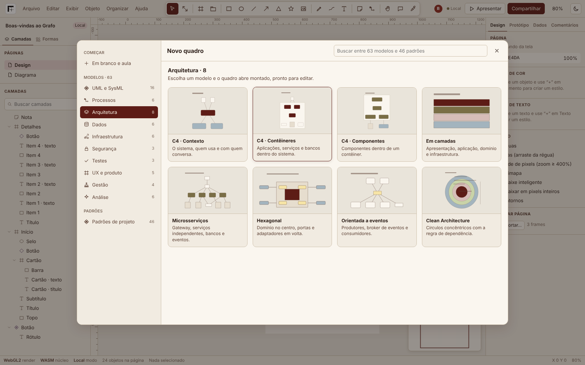
  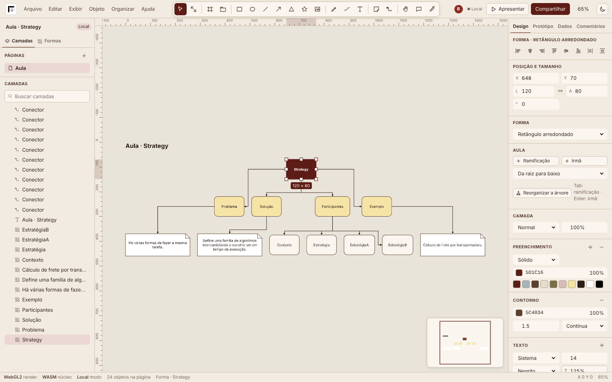
</p>

**Arquivo → Novo quadro…** (Ctrl+Alt+N) abre a galeria. Cada modelo cria um arquivo novo com o quadro já montado, com formas, textos e conectores de verdade, prontos para editar; a busca encontra pelo nome ou pela descrição e os mesmos modelos aparecem nas **Ações rápidas** (Ctrl+K).

| Começar | O que abre |
|---|---|
| Em branco | Uma página vazia |
| Aula · Da raiz para baixo | A raiz no topo e as ramificações descendo |
| Aula · Ramificações | A raiz à esquerda e as ideias se abrindo para os lados |
| Aula · História ao contrário | Comece pelo fim e suba até a origem, com as setas apontando para a raiz |

| Categoria | Modelos |
|---|---|
| UML e SysML (16) | Classe, sequência, caso de uso, máquina de estados, atividade, componente, implantação, objeto, pacote, comunicação, tempo, visão geral de interação, requisitos, definição de blocos (BDD), bloco interno (IBD) e paramétrico |
| Processos (6) | Fluxograma, BPMN 2.0, fluxo de dados (DFD), mapa de processo, SIPOC e árvore de decisão |
| Arquitetura (8) | C4 contexto, C4 contêineres, C4 componentes, em camadas, microsserviços, hexagonal, orientada a eventos e Clean Architecture |
| Dados (6) | Entidade-relacionamento, modelo relacional, esquema de banco, data warehouse, pipeline de dados e árvore JSON |
| Infraestrutura (6) | Rede, arquitetura em nuvem, Kubernetes, Docker e contêineres, CI/CD e topologia de ambientes |
| Segurança (3) | Modelo de ameaças (STRIDE), fluxo de autenticação (OAuth 2.0 + PKCE) e Zero Trust |
| Testes (3) | Pirâmide de testes, plano de testes e máquina de estados de teste |
| UX e produto (5) | Jornada do usuário, fluxo do usuário, wireframe, roadmap e Kanban |
| Gestão (4) | Organograma, matriz RACI, Gantt e matriz de riscos |
| Análise (6) | Mapa mental, Ishikawa, SWOT, Venn, matriz 2×2 e pirâmide de conceitos |
| Padrões de projeto (46) | Os 23 do GoF, Object Pool e Null Object, Repository, Unit of Work, Specification, injeção de dependência, Service Locator, MVC, MVVM, CQRS, Event Sourcing, Publish/Subscribe, Circuit Breaker, Retry, Bulkhead, Saga, Transactional Outbox, API Gateway, Backend for Frontend, Strangler Fig, Sidecar, Ambassador e Anti-Corruption Layer. **Diagrama** abre as classes com a nota de intenção; **Aula** abre a árvore com problema, solução, participantes e exemplo |

**Na aula**, cada ideia é uma ramificação: com uma ideia selecionada, **Tab** cria uma ramificação e **Enter** uma ideia irmã, já em edição, e a árvore se reorganiza sozinha. A seção **Aula** do painel Design tem os mesmos botões, troca o sentido (da raiz para baixo, para os lados ou a história ao contrário) e reorganiza a árvore. O quadro montado não entra no desfazer: Ctrl+Z desfaz só o que você mudou depois.

## Ferramentas profissionais (1.2.0)

<p align="center">
  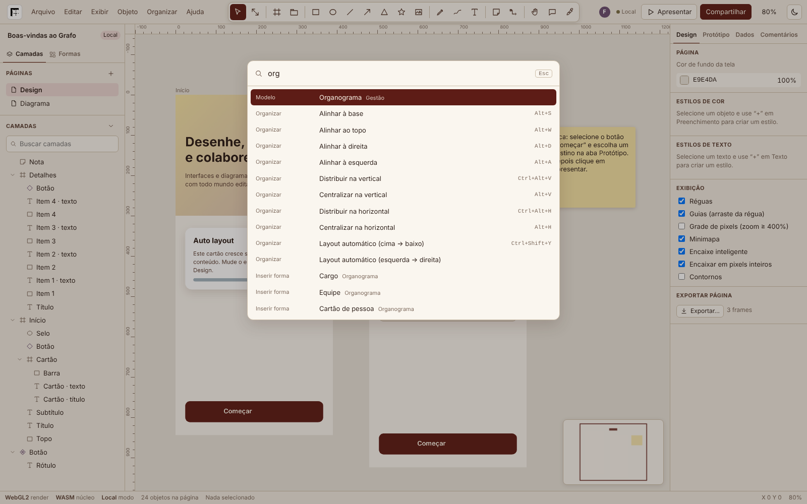
  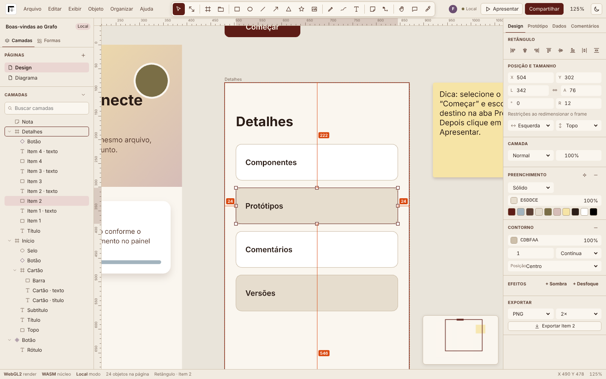
</p>

| Recurso | Como usar | O que faz |
|---|---|---|
| Ações rápidas | Ctrl+K ou Ctrl+P | Busca qualquer comando dos menus, ferramenta, página, forma das bibliotecas, componente ou camada pelo nome, sem acento e em qualquer ordem de palavras; setas escolhem, Enter executa e os últimos usados aparecem primeiro |
| Medir distâncias | Selecione e segure Alt | Mostra em pixels a distância até o objeto sob o mouse ou, sem nada embaixo, até as bordas do frame pai |
| Conta-gotas | I | Pega a cor de onde você clicar e aplica no preenchimento da seleção (no texto, na cor do texto; em linhas e conectores, no contorno); sem seleção, copia o hexadecimal. No Chrome, no Edge e no app desktop usa o conta-gotas do sistema, que lê qualquer pixel da tela |
| Guias | Arraste da régua; Shift+G mostra ou esconde | Linhas fixas por página, com encaixe ao mover, desenhar e redimensionar; arraste a guia de volta para a régua para tirar e use **Exibir → Remover guias da página** para limpar |
| Copiar e colar propriedades | Ctrl+Alt+C / Ctrl+Alt+Shift+V | Leva preenchimento, contorno, raio, opacidade, mistura, efeitos e estilo de texto de um objeto para outros |
| Organizar em grade | Ctrl+Alt+Shift+T | Arruma a seleção em linhas e colunas com espaçamento igual, mantendo a ordem de leitura |
| Renomear | F2 | Com uma camada, edita o nome no painel; com várias, renomeia em lote com `$n` para numerar e `$&` para repetir o nome atual |
| Travar proporção | Botão de corrente entre **L** e **A** | Mudar a largura ajusta a altura (e o contrário) e as alças mantêm a proporção |
| Ajustar ao conteúdo | Ctrl+Alt+Shift+R | Encolhe ou estica o frame ou a seção até caber exatamente nos filhos |
| Maiúsculas e minúsculas | Seção **Texto** | Como foi digitado, MAIÚSCULAS, minúsculas ou Primeira Letra Maiúscula, sem mudar o texto guardado |
| Copiar como PNG | Ctrl+Shift+C ou clique direito | Copia a seleção como imagem para colar em outros programas |
| Trocar preenchimento e contorno | Shift+X | Inverte as duas cores |
| Duplicação inteligente | Ctrl+D | Duplique, mova a cópia e o próximo Ctrl+D repete o mesmo deslocamento |
| Navegar pelas camadas | Tab / Shift+Tab | Seleciona a próxima ou a anterior camada do mesmo nível |
| Busca de camadas | Campo **Buscar camadas** | Filtra a árvore pelo nome e mostra o caminho de cada camada; clicar leva até ela; Alt+L recolhe ou expande todas |
| Espelhar | Shift+H / Shift+V | Inverte formas assimétricas, polígonos e imagens; com vários objetos, espelha o conjunto, e os conectores trocam de lado junto |

Também foram corrigidos: abrir ou criar outro arquivo deixava o arquivo anterior respondendo ao teclado e ao mouse por trás e repetia o botão **Apresentar** na barra; o Shift+C não abria a aba **Comentários**; e a sombra com deslocamento vertical zero aparecia 4 px abaixo no canvas e não no arquivo exportado.

## App desktop e tutorial rápido (1.1.0)

<p align="center">
  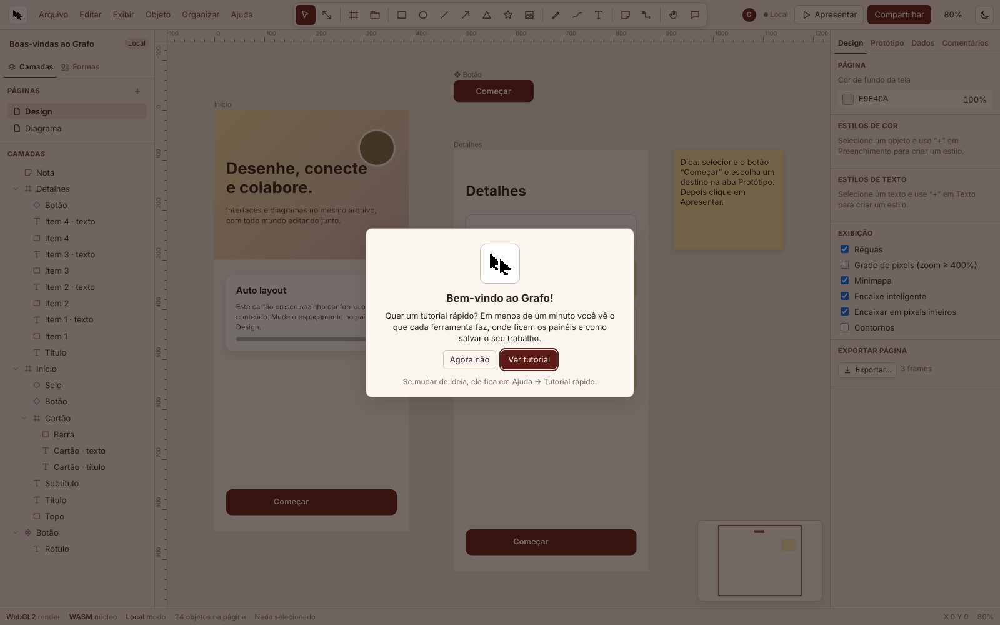
  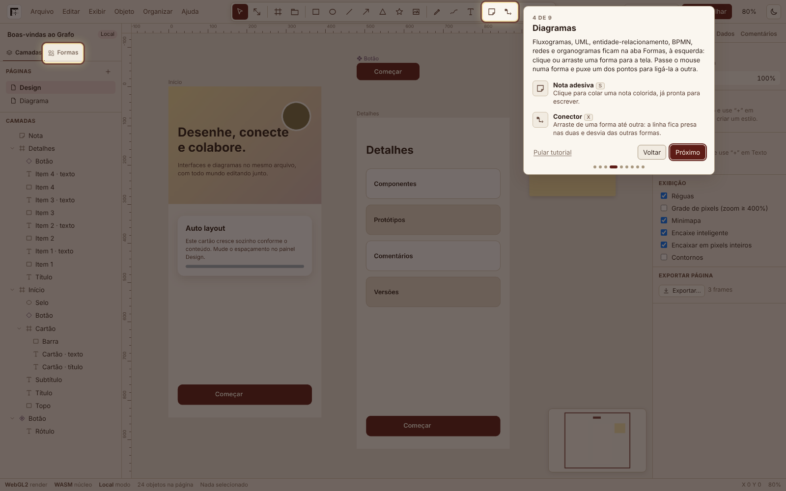
</p>

### App desktop (Grafo.exe)

O [`Grafo.exe`](Grafo.exe) é o Grafo como programa do Windows: dois cliques e o editor abre **maximizado**, numa janela própria com o ícone do projeto, sem servidor, sem navegador e sem instalador. É o mesmo editor do `Grafo.html`, embutido num programa pequeno em Go com o WebView2 do Windows ([`desktop/`](desktop/)).

| Ao salvar | Como rodar | Janela que abre | Onde o arquivo vai |
|---|---|---|---|
| Ctrl+S, **Salvar cópia `.grafo`** e **Exportar** | App desktop (`Grafo.exe`) | A janela **Salvar como** do Windows (`desktop/save_windows.go`) | A pasta e o nome que você escolher |
| Ctrl+S, **Salvar cópia `.grafo`** e **Exportar** | Servidor completo ou `Grafo.html` | O download do navegador | A pasta de downloads |

O documento aberto continua sendo salvo sozinho a cada mudança, como antes. No app desktop, o editor manda o conteúdo para o programa em Go, que grava primeiro num arquivo temporário da mesma pasta e só depois troca pelo definitivo, para não estragar o anterior se algo falhar. Ele só aceita gravar arquivos escolhidos na janela durante a sessão.

### Tutorial rápido

Na primeira vez que o Grafo abre, uma janela pergunta se você quer um tutorial rápido: **Ver tutorial** ou **Agora não**. Ele aparece uma vez só (em cada maneira de rodar) e fica sempre em **Ajuda → Tutorial rápido**. São nove passos curtos que escurecem a tela e acendem a parte explicada:

| Passo | O que mostra |
|---|---|
| 1. Selecionar e organizar | Mover, escala, frame e seção |
| 2. Formas e imagens | Retângulo, elipse, linha, seta, polígono, estrela e imagem |
| 3. Desenhar e escrever | Caneta, lápis e texto |
| 4. Diagramas | Nota adesiva, conector e a aba **Formas** com as bibliotecas |
| 5. Páginas e camadas | O painel da esquerda: páginas, árvore de camadas, ocultar e travar |
| 6. Propriedades | O painel da direita: Design, Protótipo, Dados e Comentários |
| 7. Navegar e comentar | Mão, comentário, conta-gotas, ações rápidas, zoom, minimapa e desfazer |
| 8. Colaborar e apresentar | Quem está no arquivo, conexão, **Apresentar** e **Compartilhar** |
| 9. Salvar e exportar | Menu **Arquivo**, salvar cópia, versões e exportação (no app desktop, também a janela Salvar como e o F11) |

Cada ferramenta aparece com o ícone, o nome, o atalho e uma frase sobre o que faz e como usar; passar o mouse sobre ela destaca o botão na barra. **Próximo** e **Voltar** (ou as setas → e ←) andam entre os passos, e **Pular tutorial** ou **Esc** fecham.

## Design

### Frames, auto layout e restrições

- **Frame (F):** clique para um frame de 360×640 ou arraste para o tamanho que quiser; o painel Design traz os tamanhos prontos e a opção **Recortar conteúdo**. Objetos desenhados ou soltos dentro de um frame passam a ser filhos dele. **Seção (Shift+S)** organiza áreas da página.
- **Auto layout (Shift+A):** num frame, liga e desliga; numa seleção solta, cria o frame em volta, na direção em que os objetos já estão. No painel: direção (↓ ou →), espaçamento, margem, alinhamento no eixo cruzado (início, centro, fim, esticar), distribuição no eixo principal (início, centro, fim, espaçar) e abraçar o conteúdo em cada eixo. Textos com largura automática se ajustam sozinhos; marque **Posição absoluta** para tirar um filho do fluxo. Arraste um filho para reordenar.
- **Restrições:** para filhos de frames sem auto layout: esquerda, direita, centro, esticar ou escala na horizontal; topo, base, centro, esticar ou escala na vertical.

### Componentes, instâncias e estilos

| Ação | Como |
|---|---|
| Criar componente | Selecione e use **Objeto → Criar componente** (Ctrl+Alt+K) |
| Criar instância | Clique ou arraste o componente em **Formas → Componentes**, ou **Criar instância** no painel |
| Substituir texto ou cor | Campos da seção **Instância** no painel Design |
| Voltar ao original | **Restaurar substituições** |
| Ir ao principal | **Ir para o principal** (troca de página se precisar) |
| Desanexar | Ctrl+Alt+B: vira frame com cópias editáveis |
| Estilo de cor ou texto | Botão ✦ nas seções Preenchimento e Texto; editar o estilo de cor atualiza todos os objetos |

### Ferramentas e atalhos

| Ferramenta | Atalho | O que faz |
|---|---|---|
| Mover | V | Seleciona, move, redimensiona e gira; Ctrl + clique seleciona dentro de grupos |
| Escala | K | Redimensiona escalando também texto, contorno e raio |
| Frame / Seção | F / Shift+S | Prancheta com recorte / área nomeada |
| Retângulo / Elipse | R / O | Shift: quadrado e círculo; Alt: a partir do centro |
| Linha / Seta | L / Shift+L | Shift trava em 45° |
| Polígono / Estrela | Shift+Y / * | Lados, pontas e raio interno no painel |
| Imagem | Ctrl+Shift+K | PNG, JPEG, WebP, GIF ou SVG (também arrastando ou colando) |
| Caneta | P | Clique para retas, arraste para curvas, clique no primeiro ponto para fechar, Enter para terminar |
| Lápis | Shift+P | Mão livre, simplificado (Ramer–Douglas–Peucker) e suavizado em Bézier |
| Texto | T | Clique e digite; Esc termina |
| Nota adesiva | S | Nota colorida com sombra, já em edição |
| Conector | X | Arraste de uma forma a outra |
| Mão | H ou Espaço | Arrasta a visão (também com o botão do meio) |
| Comentário | C | Abre uma conversa no ponto clicado |
| Conta-gotas | I | Pega a cor de qualquer ponto e aplica na seleção |

| Ação | Atalho |
|---|---|
| Desfazer / refazer | Ctrl+Z / Ctrl+Shift+Z ou Ctrl+Y |
| Copiar / recortar / colar / colar no lugar | Ctrl+C / Ctrl+X / Ctrl+V / Ctrl+Shift+V |
| Duplicar (repete o último deslocamento) | Ctrl+D ou Alt + arrastar |
| Ações rápidas | Ctrl+K ou Ctrl+P |
| Copiar / colar propriedades | Ctrl+Alt+C / Ctrl+Alt+Shift+V |
| Copiar como PNG | Ctrl+Shift+C |
| Renomear (em lote com várias camadas) | F2 |
| Próxima / anterior camada | Tab / Shift+Tab |
| Medir distâncias | Alt com o mouse sobre outro objeto |
| Agrupar / desagrupar / frame da seleção | Ctrl+G / Ctrl+Shift+G / Ctrl+Alt+G |
| Avançar / recuar / frente / trás | Ctrl+] / Ctrl+[ / Ctrl+Shift+] / Ctrl+Shift+[ |
| Alinhar esquerda / centro / direita | Alt+A / Alt+H / Alt+D |
| Alinhar topo / meio / base | Alt+W / Alt+V / Alt+S |
| Distribuir / organizar em grade | Ctrl+Alt+H / Ctrl+Alt+V / Ctrl+Alt+Shift+T |
| Espelhar / trocar preenchimento e contorno | Shift+H / Shift+V / Shift+X |
| Ajustar frame ao conteúdo | Ctrl+Alt+Shift+R |
| Localizar / localizar e substituir | Ctrl+F / Ctrl+H |
| Diagrama a partir de texto | Ctrl+Alt+M |
| Inserir tabela | Shift+T |
| Conectar em sequência | Ctrl+Alt+X |
| Grade de encaixe / mover um passo da grade | Ctrl+Shift+' / Shift+setas |
| Mostrar/ocultar / bloquear | Ctrl+Shift+H / Ctrl+Shift+L |
| Opacidade de 10% a 100% | 1 … 9, 0 |
| Layout automático do diagrama | Ctrl+Shift+Y |
| Zoom / ajustar tudo / seleção / 100% | Ctrl + roda, Ctrl++ e Ctrl+- / Shift+1 / Shift+2 / Shift+0 |
| Réguas / minimapa / grade / contornos | Shift+R / Shift+M / Ctrl+' / Ctrl+Shift+O |
| Guias / recolher camadas | Arrastar da régua e Shift+G / Alt+L |
| Novo quadro (modelos e aula) | Ctrl+Alt+N |
| Aula: ramificação / ideia irmã | Tab / Enter |
| Salvar cópia .grafo / abrir / salvar versão | Ctrl+S / Ctrl+O / Ctrl+Alt+S |
| Exportar / apresentar | Ctrl+Shift+E / Ctrl+Alt+Enter |
| Ocultar interface / tema / atalhos | Ctrl+\\ / Alt+T / Ctrl+/ |

### Menus

| Menu | Comandos |
|---|---|
| Arquivo | Novo quadro (modelos e aula), diagrama a partir de texto, novo arquivo em branco, abrir `.grafo`, arquivos recentes, salvar cópia `.grafo`, salvar versão, histórico de versões, importar imagem ou SVG, importar CSV, exportar, copiar diagrama como Mermaid |
| Editar | Desfazer, refazer, copiar, recortar, colar, duplicar, excluir, copiar e colar propriedades, selecionar tudo, próxima e anterior camada, selecionar mesma cor e mesmo tipo, localizar e substituir, ações rápidas |
| Exibir | Réguas, grade de pixels, minimapa, contornos, guias, remover guias da página, grade de encaixe, encaixe inteligente, encaixe em pixels, links de protótipo, render WebGPU, zoom, tema e ocultar interface |
| Objeto | Agrupar, desagrupar, frame da seleção, auto layout, ajustar ao conteúdo, renomear, inserir tabela, criar componente, desanexar instância, booleanas, espelhar, trocar preenchimento e contorno, travar proporção, bloquear, ocultar |
| Organizar | Ordem das camadas, alinhar, distribuir, organizar em grade, conectar em sequência e layout automático do diagrama nas duas direções |
| Ajuda | **Ações rápidas**, **tutorial rápido**, atalhos, seu nome e cor, sobre o Grafo |

O clique direito no canvas abre os comandos mais usados, inclusive **Colar aqui**, **Copiar e colar propriedades**, **Organizar em grade**, **Copiar como PNG**, **Copiar como SVG**, **Copiar como Mermaid**, **Conectar em sequência** e **Renomear**; no canvas vazio, **Diagrama a partir de texto** e **Inserir tabela aqui**.

## Diagramas

| Biblioteca | Formas |
|---|---|
| Formas básicas (20) | Retângulo, arredondado, elipse, losango, triângulos, paralelogramo, trapézio, pentágono, hexágono, octógono, estrela, cruz, setas, divisa, nuvem, balão, coração e nota |
| Fluxograma (25) | Processo, decisão, início/fim, dados, processo predefinido, entrada e operação manual, documento(s), banco de dados, preparação, atraso, exibição, armazenamentos, conectores de página, junção, extração, ordenar, agrupar, soma, ou, limite de laço e anotação |
| UML (13) | Classe e interface com compartimentos, ator, caso de uso, componente, pacote, nota, estados, bifurcação, linha de vida e ativação |
| Entidade-relacionamento (5) | Entidade com PK e FK, entidade fraca, atributo, atributo chave e relacionamento |
| BPMN (11) | Tarefa, subprocesso, eventos de início, intermediário e fim, gateways exclusivo e paralelo, objeto e depósito de dados, piscina e raia |
| Rede e nuvem (16) | Servidor, base de dados, nuvem, usuário, notebook, celular, roteador, firewall, balanceador, fila, armazenamento, internet, contêiner, função, gateway de API e limite de rede |
| Organograma (3) | Cartão de pessoa, cargo e equipe |
| Wireframe e interface (14) | Botão, campo, caixa de seleção, interruptor, controle deslizante, lista suspensa, cartão, avatar, imagem, janela do navegador, tela de celular, barra de navegação, abas e etiqueta |

- **Conectores:** passe o mouse numa forma e puxe um dos quatro pontos até outra forma; clicar no ponto sem arrastar cria uma cópia da forma já ligada. O roteamento **ortogonal** usa A* numa grade de visibilidade esparsa, com penalidade de curvas e margem em volta das formas; o **curvo** sai na direção do lado escolhido; o **reto** liga direto. Pontas: nenhuma, seta, triângulo, losango, losango vazado, círculo, um, muitos, um ou muitos, zero ou muitos. Duplo clique edita o rótulo; arrastar as pontas troca a forma ligada; **Inverter** troca o sentido.
- **Contêineres:** o que é solto dentro de uma piscina, raia, limite de rede, equipe, janela de navegador ou tela de celular vira filho e se move junto.
- **Layout automático:** quebra de ciclos, camadas pelo caminho mais longo, ordenação por baricentro e coordenadas sem sobreposição, de cima para baixo ou da esquerda para a direita.

<p align="center">
  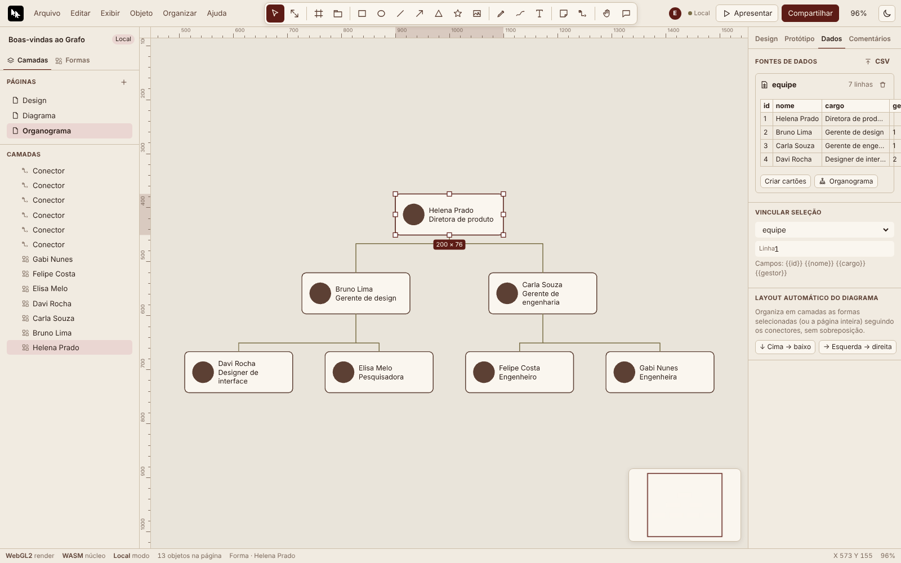
  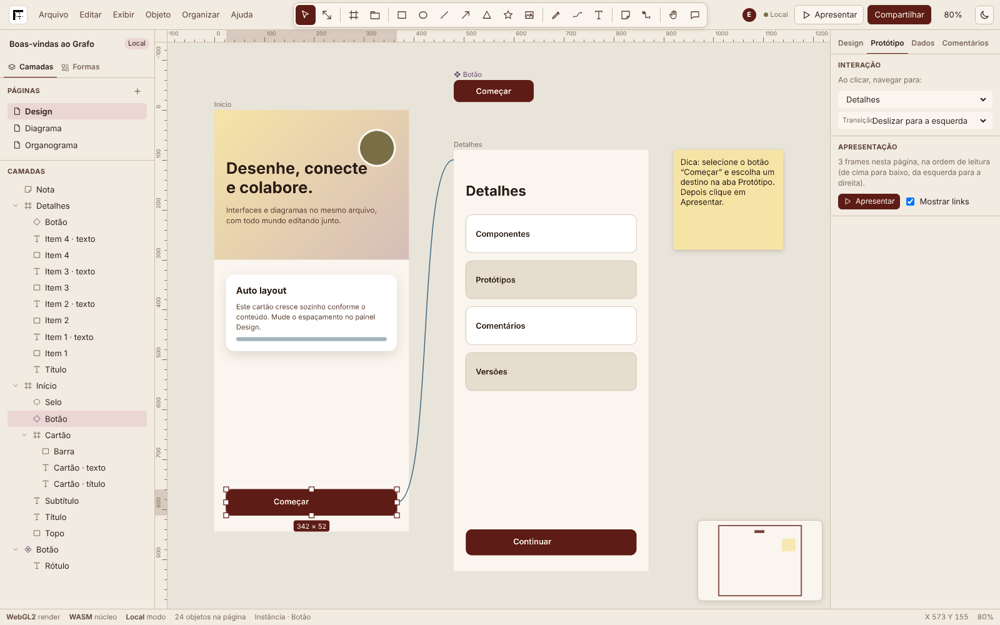
</p>

## Colaboração, comentários e versões

<p align="center">
  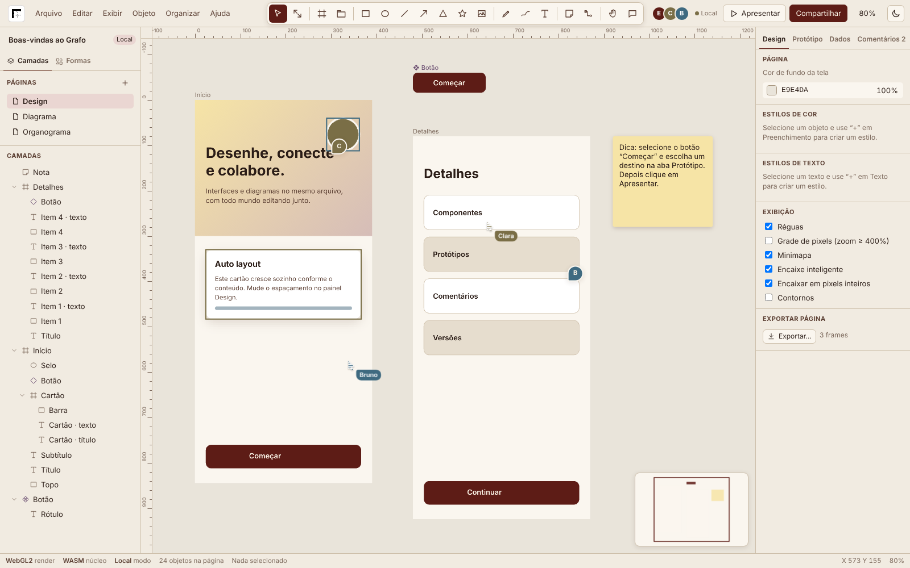
  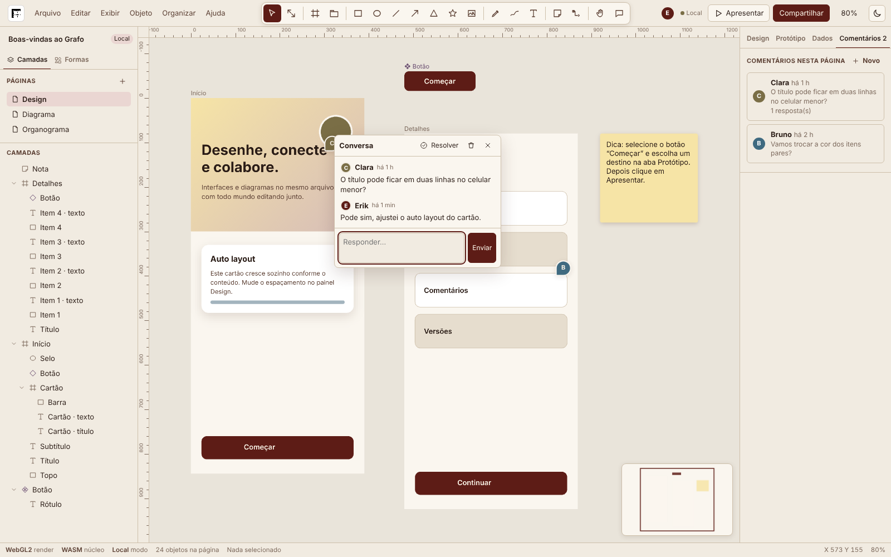
</p>

- **Tempo real:** com o servidor, quem abre o mesmo link edita junto. Cada mudança vira um update binário de poucos bytes, que o servidor aplica, distribui para a sala, publica no NATS JetStream (para outras instâncias) e grava no PostgreSQL. Ao reconectar, o cliente manda o que fez offline e recebe só o que falta.
- **Presença:** nome e cor de cada pessoa no topo, cursor ao vivo e seleção destacada na cor dela; clique no avatar para ir até o cursor. **Compartilhar** mostra o link e deixa trocar o seu nome e a sua cor.
- **Comentários:** ferramenta C, Enter envia, Shift+Enter quebra a linha; respostas, resolver, reabrir e excluir; a aba **Comentários** lista as conversas da página.
- **Versões:** **Salvar versão** (Ctrl+Alt+S) e **Histórico de versões** com autor, data, tamanho e **Restaurar**.

<p align="center">
  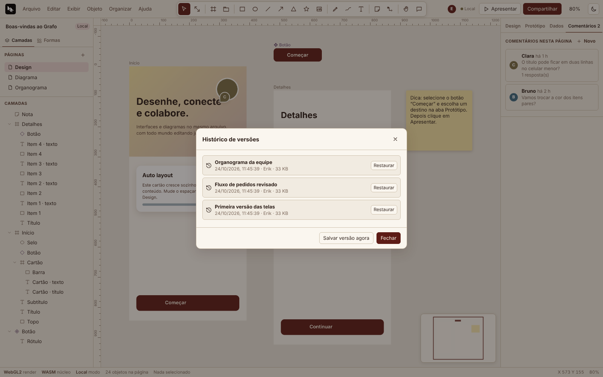
  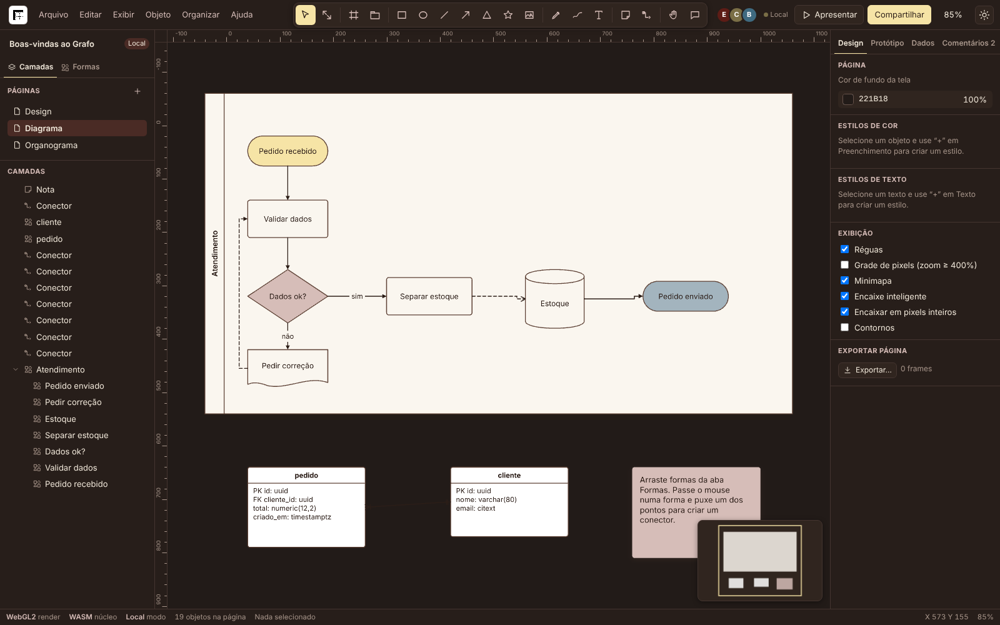
</p>

## Arquitetura

```text
Grafo.exe (Go + WebView2) ──► abre o Grafo.html embutido numa janela do Windows
                          ──► janela Salvar como nativa, tela cheia (F11), atalho no menu Iniciar

Navegador ou WebView2
  Interface (HTML/CSS/JS) ──► Estado (Y.Doc + UndoManager) ──► Renderizador (PixiJS 8: WebGL2 ou WebGPU)
           │                          │                                   │
           │                          │                  Núcleo C++ → WebAssembly (rotas, booleanas, layout, curvas)
           │                          ▼
           │               IndexedDB (cópia local) · BroadcastChannel (abas)
           ▼
  WebSocket (protocolo y-websocket) + REST
           │
Servidor Rust (Tokio + Axum)
  Salas (um Yrs Doc por arquivo) ──► PostgreSQL 17 (estado, updates, versões, comentários, imagens, dados)
                                 ──► NATS JetStream (updates entre instâncias)
                                 ──► Redis 7 (presença, cache do estado, limite de taxa)
```

- **Editor (`web/src`):** `doc.js` guarda o documento num Y.Doc (mapas de páginas, nós, comentários, estilos, dados e imagens) e mantém um espelho em memória com índice de filhos e versão por nó, refeito só quando a estrutura muda; `render.js` transforma cada nó num objeto do PixiJS e só redesenha os que mudaram; `editor.js` cuida das ferramentas, do encaixe, do auto layout e dos comandos; `panels.js`, da interface; `export.js` gera SVG, PNG, JPG e PDF sem bibliotecas externas.
- **Núcleo (`engine/`):** C++17 sem biblioteca padrão, com alocador próprio, compilado para um `engine.wasm` de 37 KB sem imports. A ponte `web/src/engine/index.js` tem versões em JavaScript de todas as funções, usadas se o WebAssembly não carregar.
- **App desktop (`desktop/`):** programa em Go que abre o `Grafo.html` embutido no WebView2 do Windows, maximizado, guarda os dados em `%LOCALAPPDATA%\Grafo` e oferece ao editor a janela Salvar como nativa (`window.grafoDesktop`).
- **Servidor (`server/`):** Axum com WebSocket, salas em memória com Yrs, compactação do estado a cada 200 updates, descarte de salas vazias, cabeçalhos de segurança e arquivos estáticos do editor. Cada serviço externo é opcional: sem eles, o servidor roda em memória e avisa no log.

### Como o documento é guardado

Cada objeto é um mapa com `id`, `type`, `page`, `parent`, `z` (ordem) e as propriedades (`x`, `y`, `w`, `h`, `rotation`, `fill`, `stroke`, `text`, `layout`, `from`/`to` nos conectores, `componentId` nas instâncias…). As coordenadas são absolutas na página; frames, grupos e contêineres apontam os filhos pelo `parent`. No servidor, o estado vai para `document_states` (binário Yrs v1) e os updates entre compactações para `document_updates`, com número de sequência; as versões nomeadas ficam em `versions`. O esquema completo está no [`Banco-de-Dados-Grafo.pdf`](Banco-de-Dados-Grafo.pdf) e em [`server/migrations`](server/migrations/0001_init.sql).

## Como rodar

| Maneira | Para quem | Colaboração | Onde salva |
|---|---|---|---|
| 1. App desktop (`Grafo.exe`) | Uso individual no Windows 10 ou 11, sem instalar nada | Só você | Neste computador, em `%LOCALAPPDATA%\Grafo`, e o `.grafo` na pasta que você escolher |
| 2. Servidor completo (Docker Compose) | Equipes, uso em rede | Em tempo real, entre computadores | PostgreSQL (e uma cópia no navegador) |
| 3. Dois cliques no HTML (`Grafo.html` ou `index.html`) | Uso individual, em qualquer sistema, sem instalar nada | Entre abas do mesmo navegador | Navegador (IndexedDB) e arquivos `.grafo` |

Para só desenhar no Windows, o app desktop é o caminho mais direto. Para editar junto com outras pessoas, suba o servidor. Para abrir em qualquer sistema sem instalar nada, use o `Grafo.html`.

### 1. App desktop (Grafo.exe)

Baixe o [`Grafo.exe`](Grafo.exe) e dê dois cliques. O Grafo abre **maximizado** (janela cheia, com a barra de título e a barra de tarefas à vista), numa janela própria, sem servidor e sem navegador. Não há instalador: o arquivo pode ficar em qualquer pasta.

- **F11** alterna a tela cheia.
- Na primeira vez que abre, o Grafo cria um atalho no **menu Iniciar** (só para o seu usuário, sem pedir administrador). Depois disso, basta pesquisar **Grafo** no Windows.
- Na primeira abertura, o Grafo também oferece um **tutorial rápido** (dá para pular; ele fica em **Ajuda → Tutorial rápido**).
- Os arquivos ficam em `%LOCALAPPDATA%\Grafo` e continuam lá na próxima vez, mesmo trocando o `.exe` por uma versão nova. A barra de status mostra **App desktop**.
- Ctrl+S, **Salvar cópia `.grafo`** e **Exportar** abrem a janela **Salvar como** do Windows.
- Usa o Microsoft Edge WebView2, que já vem no Windows 10 e 11. Se faltar, o Grafo avisa e oferece abrir a página de download da Microsoft.
- Por dentro, é um programa pequeno em Go ([`desktop/`](desktop/), cerca de 4 MB com o editor) com o `Grafo.html` embutido: o editor, os testes e a segurança são os mesmos do arquivo único.

Para gerar o `Grafo.exe` a partir do código (precisa do Node.js 22 e do Go; a versão exata fica em `desktop/go.mod`):

```bash
npm run desktop                                # atualiza o Grafo.html e gera o Grafo.exe na raiz
node scripts/build-desktop.mjs --check         # confere se o Grafo.exe do repositório corresponde ao código
```

O build é reproduzível: o mesmo código gera sempre o mesmo `Grafo.exe`, byte a byte, de qualquer sistema. O ícone é o logo do projeto ([`docs/images/logo.svg`](docs/images/logo.svg)) sobre fundo branco, desenhado com pixels inteiros em cada tamanho do Windows, e as propriedades do arquivo trazem a versão e o copyright.

### 2. Servidor completo

#### Com Docker

```bash
git clone https://github.com/ravelroot/Collaborative-Design-and-Diagram-Editor.git
cd Collaborative-Design-and-Diagram-Editor
cp .env.example .env
docker compose up -d --build
```

Troque `POSTGRES_PASSWORD` no `.env` antes de subir. Abra `http://localhost:8080`. O Compose sobe `postgres`, `redis`, `nats` (com JetStream) e `grafo`; a imagem compila o núcleo com o Emscripten, empacota o editor e o servidor Rust, roda como usuário sem privilégios, com sistema de arquivos somente leitura. As migrações rodam na primeira inicialização. Para ver o estado: `curl http://localhost:8080/api/health`.

#### Sem Docker

```bash
npm ci
npm run build
cd server
GRAFO_STATIC_DIR=../web/dist cargo run --release
```

Requisitos: Node.js 22+, Rust 1.85+ e, para recompilar o núcleo, Emscripten 4 (`bash engine/build.sh`; sem o Emscripten, o mesmo script usa o clang com alvo wasm32). Sem `DATABASE_URL`, `REDIS_URL` e `NATS_URL`, o servidor sobe só em memória.

#### Só o editor (Node.js)

```bash
npm ci
npm run build
npm run serve
```

Abre em `http://localhost:5173`, salva no navegador e as abas do mesmo arquivo colaboram entre si.

### 3. Arquivo único (Grafo.html)

Baixe o [`Grafo.html`](Grafo.html) e abra com dois cliques. O editor inteiro, com o núcleo WebAssembly embutido, abre sem servidor e sem internet, com uma Content-Security-Policy que só deixa rodar o próprio script (conferido por hash SHA-256) e bloqueia qualquer conexão de rede. Os arquivos ficam em **Arquivo → Arquivos recentes** e podem ser salvos e abertos como `.grafo`.

Para usar sem baixar, abra a [versão online](https://ravelroot.github.io/Collaborative-Design-and-Diagram-Editor/): é o mesmo `Grafo.html`, publicado no GitHub Pages, e funciona do mesmo jeito (a colaboração entre pessoas continua sendo do servidor).

| Arquivo | O que acontece ao dar dois cliques |
|---|---|
| `Grafo.html` | Abre o editor inteiro |
| `index.html` (raiz) | Abre o `Grafo.html` na hora |
| `web/index.html` | Abre o `Grafo.html` (em vez de esperar pelo build) |

Funciona no Chrome, no Edge, no Firefox e no Safari, inclusive em pastas com espaço no nome, como `C:\Users\Seu Nome\Desktop`. Para levar para outro computador, basta copiar o `Grafo.html`.

## Usando a API

Estado do servidor e dos serviços:

```bash
curl http://localhost:8080/api/health
```

Criar um arquivo (com `GRAFO_API_TOKEN` definido no `.env`):

```bash
curl -X POST http://localhost:8080/api/files \
  -H "Authorization: Bearer $GRAFO_API_TOKEN" \
  -H "Content-Type: application/json" \
  -d '{"name":"Fluxo de cadastro","kind":"diagram"}'
```

Métricas no formato do Prometheus (com `GRAFO_API_TOKEN` definido, envie o token):

```bash
curl -H "Authorization: Bearer $GRAFO_API_TOKEN" http://localhost:8080/api/metrics
```

Listar as versões de um arquivo:

```bash
curl http://localhost:8080/api/files/<id>/versions
```

| Método e rota | Para quê |
|---|---|
| `GET /api/health` | Estado do servidor, do PostgreSQL, do Redis e do NATS |
| `GET /api/metrics` | Métricas no formato do Prometheus: salas, conexões, participantes, updates aplicados e recusados, limite de taxa e serviços disponíveis (exige o token quando ele está definido) |
| `GET`, `POST /api/files` | Listar e criar arquivos (o POST aceita o `id` gerado no editor e é idempotente) |
| `GET`, `PATCH`, `DELETE /api/files/{id}` | Ler, renomear, mudar o tipo e excluir |
| `GET`, `POST /api/files/{id}/versions` | Listar e criar versões |
| `GET /api/files/{id}/versions/{vid}` | Baixar o estado binário (Yrs v1) |
| `POST /api/files/{id}/versions/{vid}/restore` | Restaurar uma versão no documento ao vivo |
| `GET`, `POST /api/files/{id}/comments` · `PATCH …/comments/{cid}` | Comentários; resolver e reabrir |
| `POST /api/files/{id}/assets` · `GET /api/assets/{aid}` | Imagens até 20 MB, tipo conferido pelos bytes e sem duplicar (SHA-256) |
| `GET`, `PUT /api/files/{id}/data-sources` | Fontes de dados (CSV) |
| `GET /ws/{file_id}` | Sala de colaboração: protocolo do `y-websocket` (sincronização, presença e pedido de presença) |

## Formato `.grafo`

O arquivo `.grafo` é JSON e guarda o projeto inteiro:

```json
{
  "format": "grafo",
  "version": 1,
  "name": "App de entregas",
  "pages": ["p1"],
  "pageInfo": { "p1": { "id": "p1", "name": "Telas", "bg": "" } },
  "nodes": {
    "n1": { "id": "n1", "type": "frame", "page": "p1", "parent": null, "z": 1, "x": 0, "y": 0, "w": 390, "h": 844, "fill": { "type": "solid", "color": "#FAF6EF", "alpha": 1 } }
  },
  "comments": {}, "styles": {}, "dataSources": {}, "assets": {}
}
```

Tipos de nó: `frame`, `section`, `group`, `rect`, `ellipse`, `polygon`, `star`, `path`, `text`, `image`, `sticky`, `shape` (com `shape` igual ao id da forma da biblioteca), `connector`, `component`, `instance` e `boolean`. As imagens ficam em `assets` como data URL.

## Configuração

| Variável | Padrão | O que controla |
|---|---|---|
| `GRAFO_BIND` | `0.0.0.0:8080` | Endereço e porta do servidor |
| `DATABASE_URL` | — | PostgreSQL; sem ela, só memória |
| `REDIS_URL` | — | Redis; sem ela, presença e limite em memória |
| `NATS_URL` | — | NATS JetStream; sem ela, uma instância só |
| `GRAFO_STATIC_DIR` | `web/dist` | Pasta do editor empacotado |
| `GRAFO_API_TOKEN` | — | Se definido (24+ caracteres), exige `Authorization: Bearer` nas escritas REST e em `/api/metrics`, e `?token=` no WebSocket |
| `GRAFO_MAX_UPDATE_BYTES` | `8388608` | Tamanho máximo de um update |
| `GRAFO_SNAPSHOT_EVERY` | `200` | Updates entre compactações |
| `GRAFO_RATE_LIMIT` | `120` | Requisições por minuto por IP |
| `GRAFO_ROOM_IDLE_SECS` | `60` | Segundos até descarregar uma sala vazia |
| `GRAFO_TRUST_PROXY` | `false` | Lê o IP do `X-Forwarded-For` atrás de proxy confiável |
| `RUST_LOG` | `info` | Nível de log |

No `.env` do Compose também ficam `POSTGRES_DB`, `POSTGRES_USER`, `POSTGRES_PASSWORD` e `GRAFO_PORT`. No editor, o renderizador WebGPU liga em **Exibir → Render WebGPU** ou com `?render=webgpu` no endereço; o padrão é o WebGL2, que funciona em todos os navegadores atuais.

## Banco de dados

| Tabela | O que guarda |
|---|---|
| `users`, `teams`, `team_members`, `projects` | Pessoas, equipes, papéis (`owner`, `editor`, `commenter`, `viewer`) e projetos |
| `files`, `file_permissions`, `share_links` | Arquivos (design, diagrama ou quadro), permissões e links de compartilhamento |
| `document_states` | Estado compactado de cada arquivo (Yrs v1), vetor de estado e última sequência |
| `document_updates` | Updates desde a última compactação, em ordem (`file_id`, `seq`) |
| `versions` | Versões nomeadas com o estado completo |
| `comments` | Conversas e respostas presas a uma página e a um ponto |
| `assets` | Imagens por arquivo, sem duplicar (SHA-256) |
| `library_components` | Componentes publicados como biblioteca |
| `data_sources` | Fontes de dados (CSV) em JSONB |

Diagramas, campos, restrições, índices e consultas prontas estão no [`Banco-de-Dados-Grafo.pdf`](Banco-de-Dados-Grafo.pdf).

## Desenvolvimento e testes

| Comando | O que faz |
|---|---|
| `npm ci` | Instala as dependências do editor |
| `npm test` | Testes do núcleo WASM e do editor (Node Test Runner) |
| `npm run build` | Empacota o editor em `web/dist` |
| `npm run portable` | Gera o `Grafo.html` |
| `npm run desktop` | Gera o `Grafo.html` e o `Grafo.exe` (precisa do Go) |
| `npm run test:e2e` | Testes ponta a ponta no Chromium (Playwright) |
| `cargo test` e `cargo clippy --all-targets -- -D warnings` (em `server/`) | Testes e análise do servidor |

| Suíte | O que cobre | Resultado |
|---|---|---|
| Núcleo C++/WASM (33 testes) | Entradas degeneradas e NaN, fuzz de 300 pares de polígonos nas quatro booleanas, rota com 500 obstáculos, índice com 10.000 caixas conferido contra força bruta, layout com 300 nós e 400 arestas, memória estável em 5.000 rodadas, WASM e JavaScript com o mesmo resultado | Rota com 500 obstáculos em 0,9 a 35 ms; 1.000 consultas no índice em 6 ms |
| Editor (30 testes) | Diagrama a partir de Mermaid (formas, setas, rótulos, `&`, `subgraph`, entrada malformada e limites) e de lista com recuo, Mermaid de ida e volta, localizar e substituir com acentos e caracteres especiais, tabela e ordem de conexão, calculadora dos campos, CSV, as 107 formas em vários tamanhos, os 63 modelos e os 46 padrões (como diagrama e como aula) montados no documento sem pontas soltas, a aula ao contrário, geometria, conectores ortogonais, cores do conta-gotas, distâncias da medição, organizar em grade, maiúsculas e minúsculas, clique em forma espelhada, desfazer só o que é seu, `.grafo` de ida e volta, três réplicas com 600 edições concorrentes entregues fora de ordem | As réplicas convergem; com 20.000 objetos, 200 consultas de filhos levam cerca de 10 ms |
| Ponta a ponta (22 cenários) | Diagrama a partir de texto e de lista, Mermaid de volta, conectar em sequência, localizar e substituir entre páginas com desfazer, tabela, grade de encaixe, espaço entre itens, estilo rápido, página vazia, Tab sem cobrir o canvas, GPU e WASM ativos, desenhar, duplicar, desfazer, refazer, mover, conectar, texto, auto layout, componente, booleana, galeria Novo quadro com modelo e aula (Tab e Enter criando ramificações), ações rápidas pelo teclado, espelhar com conectores, trocar cores, copiar e colar propriedades, organizar em grade, duplicação inteligente, Tab entre camadas, trava de proporção, conta-gotas, medição com Alt, guias puxadas da régua, ajustar ao conteúdo, renomear em lote, busca de camadas, exportação SVG e PDF, duas abas colaborando, 3.000 objetos, o `Grafo.html` direto do disco, o tutorial rápido (aparece uma vez, avança, pula e reabre pelo menu Ajuda) e a ponte do app desktop (janela Salvar como e F11), sem nenhum erro de JavaScript | Quadro com 3.000 objetos abaixo de 50 ms de CPU |
| App desktop | Build reproduzível do `Grafo.exe` (gerado de novo e comparado byte a byte), `go vet` e `gofmt` no código Go | Idêntico; 0 problemas |
| Servidor (27 testes) | Métricas do Prometheus e token exigido nelas, protocolo, UUID, limites, limite de taxa, convergência, reconexão depois de 25 updates perdidos, mensagens malformadas, 50 clientes numa sala e 20 salas em paralelo | 50 clientes convergem em 80 ms; 1.000 updates em 20 salas em 288 ms |

O CI (GitHub Actions) roda tudo a cada push, compila o núcleo com o Emscripten, confere se o `Grafo.html` está em dia com o código, gera o `Grafo.exe` de novo e compara byte a byte com o do repositório e constrói a imagem Docker.

## Qualidade e segurança

- **Navegador:** CSP sem `unsafe-eval` (o PixiJS roda no modo sem `eval` e os campos numéricos usam uma calculadora própria), `connect-src` limitado ao próprio servidor e `frame-ancestors 'none'`. Nomes de arquivos, páginas, camadas, comentários e textos entram sempre como texto, nunca como HTML. SVG importado perde scripts, eventos e referências externas e entra como imagem. Arquivos `.grafo` inválidos são recusados sem tocar no documento aberto.
- **Diagrama de texto e busca:** o leitor de Mermaid limita formas, conectores, rótulos e tamanho do texto, ignora o que não reconhece sem travar e nunca interpreta HTML; a busca trata o texto procurado como texto comum e não altera camadas bloqueadas.
- **Servidor:** UUID validado em todas as rotas, `/api/metrics` protegido pelo mesmo token das escritas, limite de tamanho por update e por imagem, tipo de imagem conferido pelos bytes, limite de requisições por IP (429 com `Retry-After`), token de API comparado em tempo constante, links de leitura que não gravam, mensagens que o Yrs não decodifica derrubam só a conexão que as mandou, e CSP com sandbox nas imagens servidas. A imagem Docker roda sem root, sem capacidades e com sistema de arquivos somente leitura.
- **App desktop:** carrega o mesmo `Grafo.html`, com a mesma Content-Security-Policy, roda sem permissão de administrador, não abre portas, desliga as ferramentas de desenvolvedor e o menu de contexto do navegador e só grava arquivos que você escolheu na janela Salvar como.
- **Dados:** o CRDT garante que todos convergem para o mesmo documento, em qualquer ordem de chegada; o desfazer de cada pessoa só mexe nas próprias alterações; o editor guarda uma cópia local no IndexedDB a cada mudança, e o servidor compacta o estado e mantém os updates com número de sequência para recuperar depois de uma queda.
- **Desempenho:** a renderização só acontece quando algo muda; os objetos fora da tela não são desenhados; a árvore de filhos, a ordem de desenho e a versão de cada nó ficam em índices que só se refazem quando a estrutura muda, e o PixiJS só redesenha os nós alterados.

### Estrutura

```text
Grafo.exe                   app desktop para Windows, que abre maximizado (gerado)
Grafo.html                  o editor inteiro num arquivo só, que abre sem servidor (gerado)
index.html                  abre o Grafo.html com dois cliques
desktop/                    código do app desktop em Go (janela WebView2, tela cheia, menu Iniciar, Salvar como, manifesto)
web/                        editor
  index.html, css/, img/    página, estilos com a paleta e logo
  boot.js                   leva ao Grafo.html quando o index.html é aberto direto do disco
  src/                      módulos: documento, render, editor, painéis, exportação, apresentação, modelos e aula, diagrama a partir de texto (Mermaid), tutorial e exemplo
  src/engine/               ponte JavaScript do núcleo WebAssembly, com versões em JavaScript
  assets/engine.wasm        núcleo compilado (gerado)
engine/                     núcleo geométrico em C++17 (include/, src/, build.sh, CMakeLists.txt)
server/                     servidor em Rust (src/, migrations/, tests/)
scripts/                    build do editor (esbuild), do Grafo.html e do Grafo.exe e servidor estático
tests/js/                   testes do núcleo e do editor
tests/e2e/                  testes ponta a ponta (Playwright)
docs/                       manuais em PDF e imagens do README
.github/workflows/          CI e publicação no GitHub Pages
Dockerfile, docker-compose.yml, .env.example
```

### Componentes de terceiros

O Grafo depende de componentes com licenças próprias, que continuam valendo para cada um deles:

| Componente | Uso no projeto | Licença |
|---|---|---|
| [PixiJS](https://pixijs.com/) | Renderização com WebGL2 e WebGPU | MIT |
| [Yjs](https://github.com/yjs/yjs), [y-websocket](https://github.com/yjs/y-websocket), [y-protocols](https://github.com/yjs/y-protocols), [lib0](https://github.com/dmonad/lib0) | Documento colaborativo e protocolo no editor | MIT |
| [Yrs](https://github.com/y-crdt/y-crdt) | Documento colaborativo no servidor | MIT |
| [Tokio](https://tokio.rs/), [Axum](https://github.com/tokio-rs/axum), [tower-http](https://github.com/tower-rs/tower-http) | Servidor assíncrono, rotas e WebSocket | MIT |
| [SQLx](https://github.com/launchbadge/sqlx) | Acesso ao PostgreSQL | MIT ou Apache-2.0 |
| [redis-rs](https://github.com/redis-rs/redis-rs) | Cliente do Redis | BSD-3-Clause |
| [async-nats](https://github.com/nats-io/nats.rs) | Cliente do NATS JetStream | Apache-2.0 |
| [Serde](https://serde.rs/), [uuid](https://github.com/uuid-rs/uuid), [chrono](https://github.com/chronotope/chrono), [sha2](https://github.com/RustCrypto/hashes), [tracing](https://github.com/tokio-rs/tracing), [DashMap](https://github.com/xacrimon/dashmap) | Serialização, identificadores, datas, hash, logs e mapas concorrentes | MIT ou Apache-2.0 |
| [esbuild](https://esbuild.github.io/) | Empacotamento do editor (só no build) | MIT |
| [Emscripten](https://emscripten.org/) | Compilação do núcleo para WebAssembly (só no build) | MIT ou UIUC |
| [Playwright](https://playwright.dev/) | Testes ponta a ponta (só no desenvolvimento) | Apache-2.0 |
| [go-webview2](https://github.com/jchv/go-webview2) | Janela do app desktop com o WebView2 (embutido no `Grafo.exe`) | MIT |
| [go-winloader](https://github.com/jchv/go-winloader) | Carregamento do WebView2 pelo go-webview2 (embutido no `Grafo.exe`) | ISC |
| [golang.org/x/sys](https://pkg.go.dev/golang.org/x/sys) | Chamadas ao Windows no app desktop (embutido no `Grafo.exe`) | BSD-3-Clause |
| [goversioninfo](https://github.com/josephspurrier/goversioninfo) | Ícone, versão e manifesto do `Grafo.exe` (só no build) | MIT |

O Microsoft Edge WebView2 Runtime faz parte do Windows e não é redistribuído no `Grafo.exe`. PostgreSQL, Redis e NATS rodam como serviços externos via Docker e não são redistribuídos neste repositório; cada um segue a licença da própria imagem. A interface usa as fontes do sistema e ícones desenhados no próprio código.

## Licença

Copyright (©) 2026 Erik Pimenta. Todos os direitos reservados.

O Grafo é distribuído sob uma [licença de uso](LICENSE) própria:

| Pode | Não pode |
|---|---|
| Baixar e usar de graça, como app desktop (`Grafo.exe`), servidor completo, só o editor ou com dois cliques no `Grafo.html` | Modificar o Grafo ou criar versões derivadas |
| Configurar pelo `.env` e pelas preferências, estilos e bibliotecas do editor | Copiar o código, no todo ou em parte, para outros projetos |
| Usar como quiser o que você cria ou exporta, inclusive em projetos comerciais | Redistribuir, publicar ou vender o Grafo |

Para pedir uma autorização que a licença não dá, fale com o autor pelo [GitHub](https://github.com/ravelroot). O texto completo está em [`LICENSE`](LICENSE).
